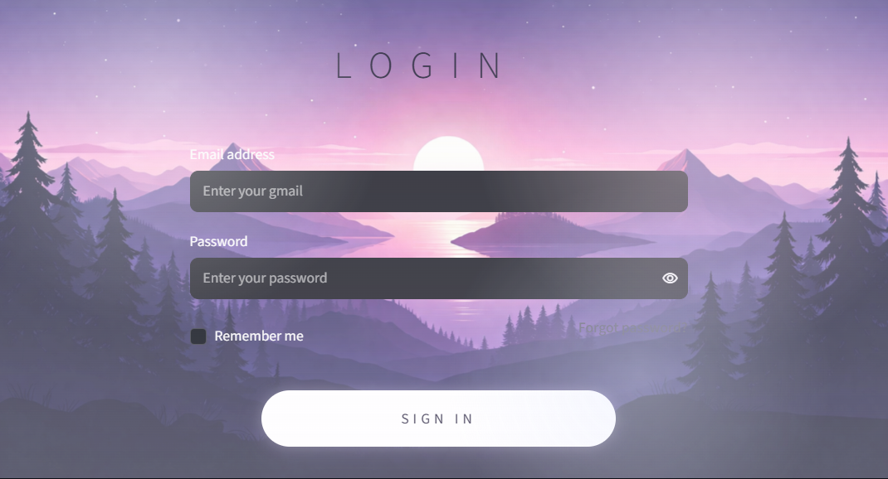

# Student Intelligence System

A Streamlit application for recording student profiles, predicting academic performance from study and wellbeing indicators, and reviewing performance trends. It includes student/staff views, bulk uploads, reports, and a SQLite-backed history.

## Problem statement

Academic teams need a consistent way to review student performance signals and identify students who may benefit from additional support. This project combines a score-estimation workflow with dashboards and recommendations. Predictions are decision-support estimates, not definitive assessments of a student's ability or wellbeing.

## Features

- Student and staff registration, login, and role-based pages.
- Individual and CSV/Excel batch score predictions.
- Performance dashboards, analytics, reports, and feedback.
- Recommendations and explanations based on submitted study and wellbeing indicators.
- SQLite persistence for local profiles, predictions, and feedback.
- Password hashing and input validation.

## Technologies

Python, Streamlit, SQLite, scikit-learn, pandas, NumPy, Plotly, bcrypt, PyJWT, and pytest.

## Requirements

- Python 3.10 or newer.
- The dependencies in `requirements.txt`.
- The trained model at `models/best_model.pkl` is included for prediction features. The source training dataset is not included.

## Installation

From this directory, create and activate a virtual environment, then install dependencies:

```powershell
py -m venv .venv
.\.venv\Scripts\Activate.ps1
python -m pip install -r requirements.txt
```

On macOS or Linux, activate with `source .venv/bin/activate`.

The app can start without email settings, but password-reset email requires valid SMTP credentials. Copy `.env.example` to `.env` to configure optional SMTP delivery. Password-reset tokens require a private JWT secret, generated for example with:

```powershell
python -c "import secrets; print(secrets.token_urlsafe(32))"
```

Set the generated value as `JWT_SECRET` in `.streamlit/secrets.toml` (create the file if needed):

```toml
JWT_SECRET = "paste-the-generated-value-here"
```

Never commit `.env` or `.streamlit/secrets.toml`. The JWT secret is required when creating or validating password-reset tokens; there is no built-in production secret.

## Run

```powershell
streamlit run app.py
```

The application creates its SQLite database under `data/` when it starts. Register an account in the app; this repository does not ship default login credentials. Prediction pages require the model file described above.

## Deploy to Streamlit Community Cloud

1. Push this project directory to a GitHub repository. Keep the repository root at this directory (`app.py` and `requirements.txt` should be at the root).
2. In Streamlit Community Cloud, create an app from the repository, select the deployment branch, and set the main file path to `app.py`.
3. In the app's **Settings → Secrets**, configure:

   ```toml
   JWT_SECRET = "replace-with-a-long-random-secret"
   # Optional email delivery:
   EMAIL_SENDER = "your-sender@example.com"
   EMAIL_PASSWORD = "your-smtp-app-password"
   ```

4. Deploy and register an account in the app.

The app reads configuration from Streamlit secrets or environment variables. Do not put actual credentials in this repository. Without SMTP credentials, email features will not send mail. The compatible four-input model is included under `models/`. Community Cloud's local filesystem is not durable storage; do not use the bundled SQLite approach for persistent student records. Treat a public deployment as a demo and do not enter real student information.

## Tests

```powershell
python -m pytest tests
```

Or run the test runner:

```powershell
python run_all_tests.py
```

Tests use a temporary SQLite database and a deterministic stand-in estimator so they can exercise prediction-service behavior without distributing a trained model or student dataset. They do not evaluate the trained model's predictive quality.

## Dataset and model evaluation

The source training dataset is kept out of the public repository. To train from the supplied student-habits workbook, use columns `study_hours`, `attendance`, `sleep_hours`, `mental_health`, and `exam_scores`. The four habit/wellbeing fields are model inputs; `exam_scores` is the target to predict. The script also accepts the equivalent CSV column names `study_hours_per_day`, `attendance_percentage`, `mental_health_rating`, and `exam_score`. Part-time-job status is not used.

```powershell
$env:SIS_DATASET_PATH = "C:\path\to\student_habits_performance.xlsx"
python -m scripts.retrain_model
```

The script saves `models/best_model.pkl` and reports holdout R², MAE, and RMSE. These are evaluation metrics, not a guarantee of future performance. The model is trained from an open-source dataset; the workbook itself is not included.

## Screenshots



## Project structure

```text
app.py                 Streamlit entry point
auth/                  Registration and authentication
config/                Application settings
database/              SQLite access
docs/                  Architecture and workflow documentation
models/                Training notebook and local model artifact
pages/                 Streamlit page content
scripts/               Data and model utilities
services/              Prediction, reports, insights, and recommendations
static/                App styles and assets
tests/                 Automated tests
utils/                 Validation, security, and logging helpers
```

## Limitations and future work

- Prediction requires a model artifact trained with the four runtime input columns; the training data is not shipped.
- The reported evaluation describes a fixed holdout split of this dataset; it does not establish generalization or suitability for high-stakes academic decisions.
- Review authorization, privacy, fairness, and retention policies before using this application with real student records.
- Add privacy-safe screenshots and a clearly sourced, redistributable dataset when available.
